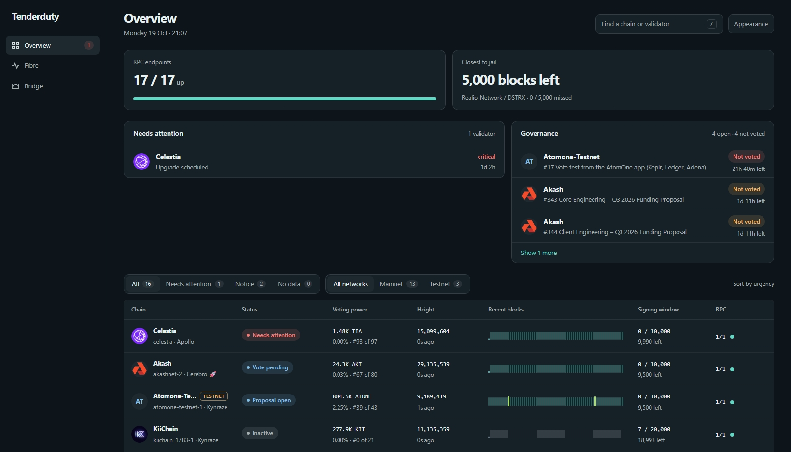

# TenderDuty v2

[](https://pkg.go.dev/github.com/kynraze/tenderduty/v2)
[](https://github.com/kynraze/tenderduty/actions?query=workflow%3AGosec)
[](https://github.com/kynraze/tenderduty/actions?query=workflow%3ACodeQL)

Tenderduty monitors Tendermint validators and alerts when they miss blocks, get jailed, or a node goes down.

This is a fork of [blockpane/tenderduty](https://github.com/blockpane/tenderduty) maintained by [Kynraze](https://github.com/kynraze). Configs from the original still load. This fork includes:

- Dashboard with filters, chain details and themes.
- Alerts to PagerDuty, Discord, Telegram, Slack and Gotify, with [severities](docs/config.md#severity) and [escalation](docs/config.md#escalation).
- Telegram [commands](docs/telegram.md#commands): `/status`, `/report`, `/mentionme`.
- [Reload](docs/config.md#reload) without restart: `tenderduty reload` or SIGHUP.
- [Chain files from the CLI](docs/config.md#chain-commands): `tenderduty chain add/set/remove`.
- Daily and weekly [reports](docs/config.md#reports).
- [One staged signing alert](docs/config.md#alerting-settings): missing blocks, near jail, jailed.
- Governance, upgrade and Celestia signalling alerts.
- Celestia [bridge](docs/bridge.md) and [Fibre](docs/fibre.md) monitoring.
- Realio [multistaking](docs/config.md#several-validators-on-one-chain).
- Fewer false alerts after restarts.
- [Docker image](docs/install.md#docker-container) `ghcr.io/kynraze/tenderduty`.



## Quick start

Docker:

```
mkdir tenderduty && cd tenderduty
docker run --rm ghcr.io/kynraze/tenderduty:latest -example-config >config.yml
mkdir chains.d && docker run --rm ghcr.io/kynraze/tenderduty:latest -example-chain >chains.d/Osmosis.yml
# edit config.yml for the notification methods, and chains.d/Osmosis.yml for the chain
docker run -d --name tenderduty --restart unless-stopped \
  -p 8888:8888 -p 127.0.0.1:28686:28686 \
  -v tenderduty-state:/var/lib/tenderduty \
  -v $(pwd)/config.yml:/var/lib/tenderduty/config.yml \
  -v $(pwd)/chains.d:/var/lib/tenderduty/chains.d \
  ghcr.io/kynraze/tenderduty:latest
docker logs -f --tail 20 tenderduty
```

From source (Go 1.27.1 or later):

```shell
git clone https://github.com/kynraze/tenderduty.git
cd tenderduty
go build -mod=readonly -ldflags '-s -w' -trimpath -o tenderduty .
cp examples/config.yml config.yml
mkdir chains.d
./tenderduty chain add <valoper> --node <url>
# edit config.yml for the notification methods
./tenderduty
```

See [installation](docs/install.md) for Docker Compose, systemd and dashboard access.

## Configuration

Shared settings go in `config.yml`. Each chain has its own file in `chains.d`, named after the chain: `chains.d/Osmosis.yml` is "Osmosis". Start from [examples/](examples) or `tenderduty chain add`, and apply changes with `tenderduty reload`. See [config.md](docs/config.md).

## Options

```
$ tenderduty -h
Tenderduty monitors Tendermint validators and alerts when they miss blocks, get jailed or a node goes down.

Usage:
  tenderduty [flags]
  tenderduty [command]

Available Commands:
  start       Run tenderduty (the same as no command)
  chain       Add, change, remove or list chains
  config      Show or change config.yml
  reload      Reload a running tenderduty
  version     Print the version
  help        Help about any command

Flags:
  -home string               directory for config.yml, chains.d and the state file, or env TENDERDUTY_HOME
                             (default: the current directory if it has config.yml, else /etc/tenderduty
                             with the state in /var/lib/tenderduty)
  -f string                  config file, or env CONFIG (default "config.yml", or <home>/config.yml)
  -cc string                 chain config directory (default "chains.d", or <home>/chains.d)
  -state string              state file (default ".tenderduty-state.json", or <home>/.tenderduty-state.json)
  -example-config            print an example config.yml and exit
  -example-chain             print an example chains.d/<Chain>.yml and exit
  -example-celestia          print an example chains.d/Celestia.yml with Fibre and exit
  -version                   print the version and exit
  -h, -help                  help for tenderduty

Remote config (see docs/remote.md):
  -encrypt                   encrypt -f to -encrypted-config
  -decrypt                   decrypt -encrypted-config to -f
  -encrypted-config string   encrypted config file (default "config.yml.asc")
  -password string           password for -encrypt/-decrypt, or env PASSWORD, prompts if unset

A relative -f, -cc or -state is relative to the current directory, not to -home.
With -home /etc/tenderduty, state defaults to /var/lib/tenderduty/.tenderduty-state.json.

Use "tenderduty [command] -h" for more information about a command.
```

## Documentation

See the [docs](docs/README.md): installation, [configuration](docs/config.md), PagerDuty, Discord, Telegram, Gotify, Prometheus, Celestia Fibre and bridge, remote config and Akash.

## Contributions

Please open pull requests against the `main` branch of [kynraze/tenderduty](https://github.com/kynraze/tenderduty).
