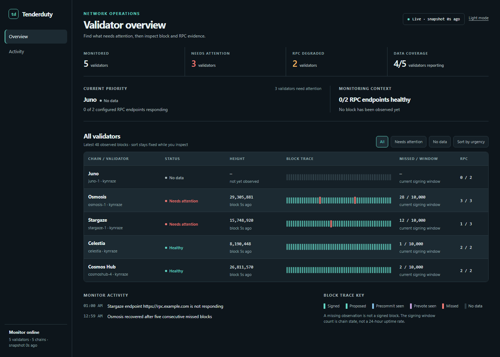

# Tenderduty Docs

### What is tenderduty?

This is a tool for validators running tendermint nodes. It sends notifications when it detects problems.

## Detailed Documentation Topics

- [Installation](install.md)
- [Shared Configuration File Settings](config.md)
- [Settings for a chain](chains.md)
- [Setting up PagerDuty](pagerduty.md)
- [Setting up Discord](discord.md)
- [Setting up Telegram](telegram.md)
- [Prometheus Exports](prometheus.md)
- [Celestia Fibre](fibre.md)
- [Remotely Configuring Tenderduty](remote.md)
- [Running on Akash](akash.md)

## What does it do?

Monitors a validator's performance across multiple chains

- The main purpose of tenderduty is to monitor consensus state, and alert if the validator is missing blocks. This can be based on consecutive misses or on a percentage missed within the slashing window.
- Alerting if jailed, tombstoned, or inactive.
- Optional alerting on missed proposals: blocks the validator was due to propose but another validator did.
- Optional governance messages: a proposal opened for voting, and a reminder before voting ends without a vote.
- Optional upgrade messages: an upgrade scheduled in x/upgrade with its estimated time, and a reminder before it.
- Optional jail risk alerts, from the chain's own slashing params.
- Optional quiet hours, holding back the quieter alerts overnight and sending what is still alarming once they end.
- Alert destinations can be customized for each chain.
- Monitors node health:
    * Optional alerting if syncing or not responding.
    * Configurable threshold to wait before alerting on downtime
- If no nodes are alive it can fallback to using public RPC nodes.

Provides a prometheus exporter for integration with other visualization systems.<br />
Sends an alert to any of three destinations: Pagerduty, Discord, or Telegram.

A dashboard for displaying status.

- The missed block grid was heavily influenced by the uptime display on [ping.pub](https://ping.pub). *Many thanks for the inspiration!*
- The overview shows the last 48 observations beside each validator. Open a chain to see its full 512-observation history.
- Displays a table showing validator and node status.
- Filters make it possible to focus on chains that need attention or have no data.
- Shows the last observed block time and browser connection state separately.
- Designed intentionally for maximum density for validators on a lot of chains.
- Four appearance presets and custom colors. See [Dashboard Appearance](#dashboard-appearance) below.
- Optionally shows a real-time stream of log messages with details about ongoing health checks.

The missed count is labeled as a signing-window value. It is not a daily uptime percentage. State is saved every minute and on shutdown using a temporary file before replacing the previous snapshot.

Failed notification deliveries are retried with a delay. Alerts and recoveries are queued in order for each incident and destination, and saved before delivery. An incident that recovers before its first delivery is skipped. Pending notifications resume after a restart using the current notification settings. Delivery state is recorded only after the destination accepts the message.

Signing-query failures retain the last known values and mark them as stale. Stale signing data cannot clear percentage or tombstone alerts; failed validator-status queries cannot clear inactive alerts. RPC endpoints have independent connection timeouts, and reconnects rotate through the configured endpoints. Block signatures are checked against their commit height; missing observations across reconnects are shown as unknown.

During shutdown, monitoring workers stop and active notification requests have up to 20 seconds to finish before cancellation. The final state is saved after workers exit. If a destination accepts a message just before a crash prevents its acknowledgement from being saved, the message may be delivered again after restart.

When the dashboard is enabled, `/health` reports process liveness and `/ready` reports monitoring readiness. `/ready` returns HTTP 503 until at least one validator is monitored. Both responses include counts for monitored validators, unavailable RPC connections, and stale validator information. The outbound healthcheck remains a process heartbeat; only HTTP 2xx responses count as successful pings.



The screenshot uses example data.

## Dashboard Appearance

Click **Customize** in the dashboard to select a theme:

| Theme | Appearance |
| --- | --- |
| Graphite | Dark charcoal with a teal accent; the default theme. |
| Midnight | Dark navy with a blue accent. |
| Paper | Light surfaces with a teal accent. |
| Warm Stone | Warm light surfaces with a brown accent. |
| Custom | Your own background, panel, and accent colors. |

For **Custom**, use the color pickers or enter six-digit HEX colors, such as `#17212B`. Text and status colors adapt automatically. Invalid colors and combinations with insufficient text or accent contrast show an error and disable **Apply**.

- Changes preview live while the dialog is open.
- **Apply** saves the selected appearance in this browser.
- **Cancel**, or pressing Escape, restores the previously applied appearance.
- **Reset** previews Graphite. Click **Apply** to save the reset.

Appearance settings are independent of `config.yml`, alert settings, and other visitors' preferences. They persist across reloads in the same browser. If browser storage is unavailable, changes apply for the current session only. Existing light-mode preferences migrate to Paper.

## System Requirements:

* CPU: minimum of 1 core
* Memory: 128MB minimum, 256MB strongly recommended for containers.
* Bandwidth: 
  * Inbound: ~500KiB/s per-validator. Ex: monitoring 16 validators consumes 8MiB/s inbound.
  * Outbound: negligible, ~5-10 KiB/s per validator.
* Storage: ~60MB for the Docker container, ~35MB for binary alone. The cache file should be only a few KB.

## How does it work?

For each chain being monitored:

* Sets up an RPC client
  - On the initial connection it will get the validators consensus key and convert to a valcons bech32 address.
  - Occasionaly checks for validator state: active, jailed, tombstoned
  - Checks for a count of missed blocks within the jailing window.
* Uses a websocket to subscribe to NewBlock and Vote events.
  - The votes are used to determine if a pre-vote/pre-commit was sent by the validator.
  - The finalized blocks are checked for the validator's signature.
* Once/minute checks the health of all nodes by creating a new RPC client and getting the status.
* If all configured nodes are down it can use the [cosmos.directory](https://cosmos.directory) to locate a public RPC node.

Dashboard:

* The dashboard provides a stream of missed block and validator status information over a websocket
* Missed blocks are displayed on a grid. This grid uses different colors to represent the validator's consensus state
  * Signed blocks are muted. This should be the nominal state, so anything else stands out.
  * Missed blocks are red, with a stroke through them in the chain's full history.
  * Not all missed blocks are the same. It is useful to know if a validator sent a pre-commit or even a pre-vote and was not included in the block. This might indicate peering issues, or even that another validator is having problems and missing pre-commits from others.
  * Bright green is used to indicate a block the validator proposed.
  * Blocks with no data are hollow. On (re)connect, the empty places in the recent trace are filled in from the node's commits, which can tell signed, proposed and missed apart but not prevote/precommit seen or missed proposals.
  * Amber marks a missed proposal: the validator was the proposer for the block's first round, but another validator proposed it. There is no slashing for this, it is usually a slow node or network.

Notifications:

* For Discord and Telegram it will only send an alert on a new alarm and when the alarm clears. Pagerduty has a little more nuance.
* Telegram, Discord and Slack show each notification as a card: the chain and what happened on top, then a line for each fact with an icon and a label, and a coloured dot where something can be good or bad. A cleared alert says what is true now and how long it lasted. In Discord the lines are the embed's fields and `extra_info` is its footer, in Slack they are the attachment's fields. Pagerduty gets the plain text. In Telegram:

```
🚨 Devnet1 · Fibre down

🌐 Host: localhost:7980
⛓ Chain: devnet-1
📡 Reachable: 🔴 no, for 2m
❓ Why: connection refused: Fibre is not listening on that port
⚠️ Severity: critical
```

```
✅ Devnet1 · Fibre up

🌐 Host: localhost:7980
⛓ Chain: devnet-1
📡 Reachable: 🟢 yes
⏱ Lasted: 12m
```

* One event is one message. Alarms that clear together for the same reason are announced once: a proposal's alarm and its vote reminder, an upgrade and its reminder, a signalling version's alarms when it upgrades, the jailed alarm and "can unjail" when the validator is unjailed, a Fibre host's alarms when it moves. A tombstone is permanent, it is sent once and never cleared in a chat. Pagerduty still resolves every incident.

* Pagerduty:
  * Pro-tip: the alarms sent to pagerduty all use a unique "key". Pagerduty will automatically de-deduplicate alerts based on this key. If you want redundant monitoring you can run multiple instances of tenderduty alerting to pagerduty and will not get duplicate alerts.
  * Additional flapping detection is applied to pagerduty (not to discord or telegram). If a node is going up and down every few minutes it will only send an alert once in a five minute period.
