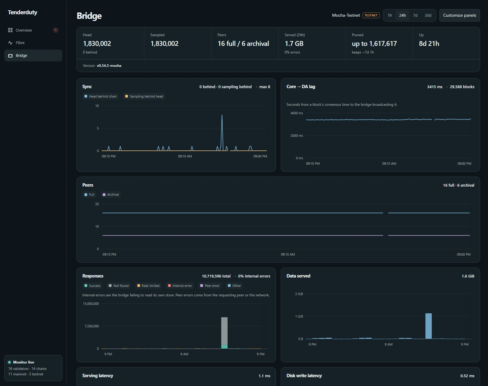

# Celestia bridge

Tenderduty checks one celestia-node bridge per chain every 30 seconds over its RPC, with read methods only: local head, sampling, and header lag against the chain. With the bridge's OTel metrics it also watches peers, serving errors and pruning.

## Setup

1. On the bridge host, create a read token and save it in a file tenderduty can read:

   ```shell
   celestia bridge auth read --p2p.network <network> --node.store <store>
   ```

2. Start the bridge with `--rpc.addr 0.0.0.0` (the default is localhost only) and allow port 26658 from tenderduty's IP only. Over plain HTTP the token travels unencrypted.

3. On tenderduty's machine, check the bridge and save it to `chains.d/<Name>.yml`:

   ```shell
   tenderduty chain bridge <Name> http://<bridge-ip>:26658 --token-file /etc/tenderduty/bridge.token --alert yes
   ```

`chain bridge` flags:

| Flag | Use |
| --- | --- |
| `--token-file <path>` | The read token file. Leave out for a bridge with `--rpc.skip-auth`. |
| `--alert yes\|no` | Sets `bridge_enabled`. |
| `--force` | Save even if the check fails. |
| `--endpoint <url>` | Address for the printed metrics flags, when it differs from `otel_metrics.listen` (NAT, proxy). |

Or by hand in the chain file:

```yaml
bridge:
  url: http://<bridge-ip>:26658
  token_file: /etc/tenderduty/bridge.token
alerts:
  bridge_enabled: yes
```

Notes:

- With only `bridge.url`, status, the dashboard, reports and metrics show the bridge; `bridge_enabled` adds the alerts.
- The token file is read on start and reload. The token never appears in status, logs, state or metrics.

### Metrics

Optional. Needed for peers, serving errors, pruning and the Bridge tab. `chain bridge` prints these lines.

1. Add to `celestia bridge start`:

   ```
   --metrics --metrics.endpoint <tenderduty-ip>:4318 --metrics.tls=false
   ```

2. Put the token in the bridge's environment. With systemd, under `[Service]`, then reload systemd and restart the bridge:

   ```ini
   Environment="OTEL_EXPORTER_OTLP_METRICS_HEADERS=Authorization=Bearer <token>"
   ```

Behind Caddy or nginx with HTTPS, use the domain without a scheme and turn TLS on: `--metrics.endpoint otel.example.com --metrics.tls=true`. `chain bridge --endpoint https://otel.example.com` prints this.

The bridge uses the same listener and token as Fibre, see [Fibre setup](fibre.md#setup). It labels its metrics with its network, which must match the chain's `chain_id`.

**Already sending to Celestia's collector?** The bridge has only one `--metrics.endpoint`. Run a Collector on the bridge host, start the bridge with `--metrics --metrics.tls=false` (the endpoint defaults to `localhost:4318`), and let the Collector send to both. The tenderduty token goes on the Collector, not the bridge, so Celestia never sees it: drop the bridge's `OTEL_EXPORTER_OTLP_METRICS_HEADERS`. Celestia's collector needs no token. Older Collectors name the exporter `otlphttp`.

```yaml
receivers:
  otlp:
    protocols:
      http:
        endpoint: 127.0.0.1:4318
exporters:
  otlp_http/tenderduty:
    endpoint: https://otel.example.com   # behind Caddy/nginx; or http://<tenderduty-ip>:4318
    headers:
      Authorization: Bearer <token>   # otel_metrics.token, also through the proxy
  otlp_http/celestia:
    endpoint: https://<celestia-collector>
service:
  pipelines:
    metrics:
      receivers: [otlp]
      exporters: [otlp_http/tenderduty, otlp_http/celestia]
```

## Alerts

All use `bridge_severity` (default warning) and the chain's routing, mentions and quiet hours. Lag is `bridge_lag_blocks` (20) for `bridge_lag_minutes` (5). Settings are in [config.md](config.md#alerting-settings) and apply on reload.

With `bridge_enabled`:

| Alert | Fires when |
| --- | --- |
| Unreachable | Three checks in a row fail. |
| Token rejected | The bridge answers 401, 403 or missing permission. Replaces unreachable. |
| Behind | The header lag stays over the threshold. Skipped while checks fail or the chain height is unknown. |
| Sampling stuck | Sampling stops, or its lag stays over the threshold. |

With metrics too, while the RPC is up:

| Alert | Fires when |
| --- | --- |
| Too few peers | Fewer than 2 full peers for `bridge_lag_minutes`. |
| Serving errors | Half of at least 20 responses in `bridge_lag_minutes` are internal errors. Peer and network errors don't count. |
| Metrics stopped | No metrics for 5 minutes, after some arrived. |
| Pruning stalled | The last pruned height hasn't moved for 1 hour while the head moves. |
| Failing to prune | Prunes fail for 1 hour. |

Except metrics stopped, these clear quietly when metrics go stale or the RPC is down.


## /status and the dashboard

`/status` and the dashboard show a Bridge section: head, lag and sampled head, or why the bridge can't be reached. With fresh metrics (under two minutes old) it adds version, full and archival peers, data served in 24 hours, pruning and uptime. Daily reports include version, served bytes and peers.

The Bridge tab charts one chain over 1h, 24h, 7d or 30d: sync and sampling lag, Core → DA lag, peers, data served, responses, serving and disk write latency, pruning, memory and restarts. Customize panels shows, hides and reorders them. History is kept for 30 days.



`GET /bridge?range=24h&chain=ChainName` returns the history as JSON; omit `chain` for all bridges.

## Prometheus

Prefixed `tenderduty_bridge_` and labeled `name`, `chain_id` and `moniker`. Counters (`_total`) count while tenderduty runs, so use `rate` or `increase`.

| Source | Metrics |
| --- | --- |
| RPC | `up`, `head`, `lag_blocks`, `sampled_head`, `sampling_lag_blocks` |
| Metrics, while fresh | `info{version}`, `start_time_seconds`, `full_peers`, `archival_peers`, `retained_hours`, `memory_bytes`, `goroutines`, and when known `archival`, `last_pruned`, `failed_prunes` |
| Metrics counters | `served_bytes_total`, `responses_total{status}`, `serve_seconds_total`, `serve_requests_total`, `store_put_seconds_total`, `store_puts_total`, `store_put_failures_total`, `core_to_da_seconds_total`, `core_to_da_blocks_total`, `reclaimed_bytes_total`, `restarts_total` |

`status` is success, not_found, rate_limited, internal_err, peer_err or other. [`otel_metrics.export_raw`](fibre.md#raw-export) also serves the bridge's own metrics.
