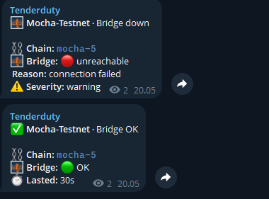

# Celestia bridge

Tenderduty checks one celestia-node bridge per chain every 30 seconds over JSON-RPC, with a 10-second timeout per call. `header.LocalHead` supplies the local height and time; `das.SamplingStats` supplies the sampled and network heights, catch-up status and whether sampling runs. Header lag is compared with the validator RPC's chain height. It is skipped when that height is unknown or the chain is down.

Create a read token on the bridge host:

```sh
celestia bridge auth read --p2p.network <network> --node.store <store>
```

Save the token in a file readable by tenderduty. It is read and trimmed at startup and on reload. The token is never included in status, logs, saved state or metrics. An empty `token_file` sends no Authorization header, for bridges using `--rpc.skip-auth`.

Start the bridge with `--rpc.addr 0.0.0.0` to accept remote RPC connections; the default listens only on localhost. Firewall port 26658 to tenderduty's IP. With plain HTTP, the token travels unencrypted.

In the chain file, next to `public_fallback`:

```yaml
bridge:
  url: http://203.0.113.10:26658
  token_file: /etc/tenderduty/bridge-mocha.token
alerts:
  bridge_enabled: yes
  bridge_severity: warning
  bridge_lag_blocks: 20
  bridge_lag_minutes: 5
```

Bridge alerts default off. With only `bridge.url` set, status, dashboard, reports and metrics still show the bridge; `bridge_enabled` turns on the alerts. The default lag threshold is 20 blocks for 5 continuous minutes; severity defaults to warning. Enabling alerts requires a URL. These alert keys also work in `alert_defaults`. URL, token file and token changes apply on reload.

| Alert | Condition | Recovery |
|---|---|---|
| Unreachable | Three consecutive failed ticks | Bridge OK |
| Token rejected | First HTTP 401 or 403, or a missing-permission reply; replaces unreachable | Bridge OK |
| Behind | Header lag exceeds the threshold for the configured window | Bridge is back in sync |
| Sampling stuck | Sampling is stopped, or sampling lag exceeds the threshold, for the configured window | Bridge sampling resumed |

Failed ticks suspend lag checks. Alerts use the chain's routing, mentions and quiet hours. `/status` and the dashboard show a Bridge section with head, lag and sampled head, or reachability and token failures. Daily reports include bridge version, served bytes and peers when OTel metrics are available.

A bridge stopped and started again on Mocha:



Prometheus exports `tenderduty_bridge_up`, `tenderduty_bridge_head`, `tenderduty_bridge_lag_blocks` and `tenderduty_bridge_sampled_head`, with `name`, `chain_id` and `moniker` labels.

Version and peers come from OTel metrics. Tenderduty uses only read RPC methods.

## Metrics (OTel)

Add `--metrics --metrics.endpoint <tenderduty-ip>:4318 --metrics.tls=false` to `celestia bridge start`. In tenderduty's `config.yml`, set the shared Fibre/bridge listener and token:

```yaml
fibre_metrics:
  listen: 0.0.0.0:4318
  token: <token>
```

In the bridge's systemd unit, under `[Service]`:

```ini
Environment="OTEL_EXPORTER_OTLP_METRICS_HEADERS=Authorization=Bearer <token>"
```

Reload systemd and restart the bridge. `service.namespace` must match the chain's `chain_id`, with `bridge.url` set.

Fibre and bridges share this listener and its one token: with `token` set, every sender uses it. Without a token, allow only the senders' IPs to port 4318 and set `allow_without_token: yes`. Plain HTTP sends the token unencrypted. HTTPS, a reverse proxy and private networks work as in [Fibre setup](fibre.md#setup). Behind a proxy, a `listen` on 127.0.0.1 needs no token, so set one anyway or let only the senders' IPs through the proxy.

`/status` and the dashboard show a Bridge section: head and sampled height, plus version, full/archival peers, served data (24h), pruning and uptime while metrics are fresh (within two minutes). Pruned or archival mode comes from the store metrics. Reports show served bytes. Prometheus adds `tenderduty_bridge_full_peers`, `tenderduty_bridge_archival_peers`, `tenderduty_bridge_start_time_seconds`, `tenderduty_bridge_info` with a `version` label, and when known `tenderduty_bridge_last_pruned`, `tenderduty_bridge_failed_prunes` and `tenderduty_bridge_archival`.

With bridge alerts enabled and RPC up:

| Alert | Condition | Recovery |
|---|---|---|
| Too few peers | Fewer than 2 full peers for `bridge_lag_minutes` | 2 or more full peers |
| Serving errors | At least 20 responses in `bridge_lag_minutes`, half of them internal errors | Below a quarter |
| Metrics stopped | No metrics for 5 minutes, after some arrived since tenderduty started | Metrics arrive |
| Pruning stalled | Last pruned height unchanged for 1 hour while the head moves | Pruning advances |
| Failing to prune | Failed prunes for 1 hour | No failed prunes |

Internal errors are the bridge failing to read its own data: a disk error, a corrupt file or a disk too slow to answer. Bad requests and dropped connections come from peers or the network and don't count. All use `bridge_severity`. Except metrics stopped, they resolve quietly when metrics go stale or RPC is down.

An archival bridge also runs the pruner, but only trims the Q4 file and keeps block data forever, so disk keeps growing. Tenderduty can't see disk space.

To send to two backends, point the bridge at a Collector with `--metrics.endpoint localhost:4318 --metrics.tls=false`. Set the tenderduty token on the Collector exporter instead of the bridge. Example Collector config (older Collectors only know the exporter as `otlphttp`):

```yaml
receivers:
  otlp:
    protocols:
      http:
        endpoint: 127.0.0.1:4318
exporters:
  otlp_http/tenderduty:
    endpoint: http://<tenderduty-ip>:4318
    headers:
      Authorization: Bearer <token>
  otlp_http/backend:
    endpoint: https://<other-backend>
service:
  pipelines:
    metrics:
      receivers: [otlp]
      exporters: [otlp_http/tenderduty, otlp_http/backend]
```


## Bridge tab

The dashboard Bridge tab shows sync and sampling lag, Core → DA lag, peers, data served, response outcomes, serving and disk write latency, pruning, memory and restarts with version changes. Latency is a sum/count average; celestia-node's histogram buckets are too coarse for percentiles. Pick a chain and range (1h, 24h, 7d, 30d). Customize panels changes visibility, order, width and count chart type. Memory and restarts are hidden by default. Blank intervals have no observation. History is kept for 30 days in the state file.

`GET /bridge?range=24h&chain=ChainName` returns the history as JSON; omit `chain` for all watched bridges.

Prometheus adds the following metrics with `name`, `chain_id` and `moniker` labels. Counters accumulate while tenderduty runs; use `rate` or `increase`. Metrics are emitted while OTel exports are fresh, except sampling lag, which comes from RPC polls.

- Counters: `tenderduty_bridge_served_bytes_total`, `tenderduty_bridge_responses_total{status}` (success, not_found, rate_limited, internal_err, peer_err, other), `tenderduty_bridge_serve_seconds_total`, `tenderduty_bridge_serve_requests_total`, `tenderduty_bridge_store_put_seconds_total`, `tenderduty_bridge_store_puts_total`, `tenderduty_bridge_store_put_failures_total`, `tenderduty_bridge_core_to_da_seconds_total`, `tenderduty_bridge_core_to_da_blocks_total`, `tenderduty_bridge_reclaimed_bytes_total`, `tenderduty_bridge_restarts_total`.
- Gauges: `tenderduty_bridge_sampling_lag_blocks`, `tenderduty_bridge_retained_hours`, `tenderduty_bridge_memory_bytes`, `tenderduty_bridge_goroutines`.

`fibre_metrics.export_raw` also forwards bridge OTLP metrics to Prometheus with the same limits and expiry as Fibre.

Check and save a bridge, then print its metrics setup: `tenderduty chain bridge <Name> <url> [--token-file path] [--alert yes|no]`.
