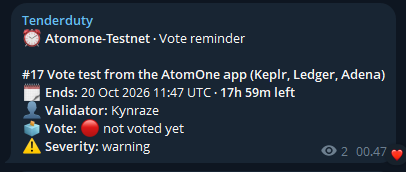
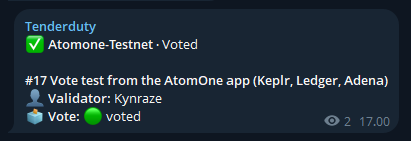
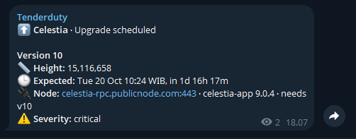
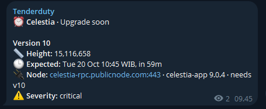
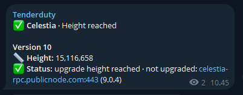
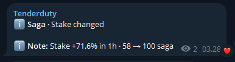
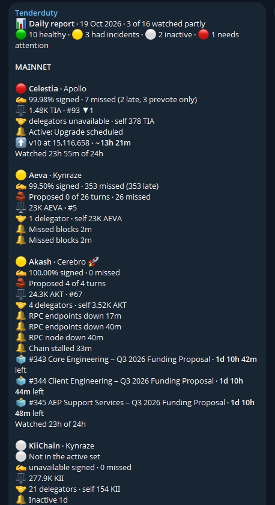
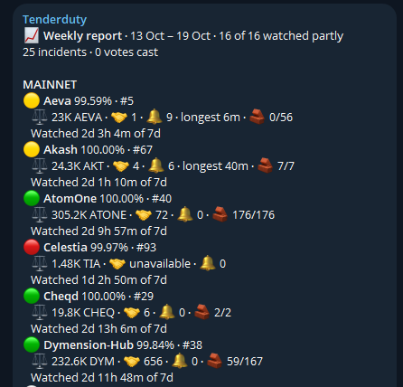

# Configuration

`config.yml` holds what every chain shares: the dashboard, alert destinations, quiet hours and `alert_defaults`. Each chain has its own file in `chains.d`. `tenderduty -example-config` prints [examples/config.yml](../examples/config.yml) and `-example-chain` prints [examples/chains.d/Osmosis.yml](../examples/chains.d/Osmosis.yml), see [install.md](install.md).

* [Files](#files)
* [General Settings](#general-settings)
* [Alert Destinations](#alert-destinations)
* [Alerting Settings](#alerting-settings)
* [Severity](#severity)
* [Validator changes](#validator-changes)
* [Quiet Hours](#quiet-hours)
* [Escalation](#escalation)
* [Reports](#reports)
* [Health Check Settings](#health-check-settings)
* [OTel Metrics](#otel-metrics)
* [Chain Settings](#chain-settings)
* [Node Settings](#node-settings)
* [Several validators on one chain](#several-validators-on-one-chain)
* [Reload](#reload)
* [From the CLI](#from-the-cli)

## Files

The sections from [General Settings](#general-settings) to [OTel Metrics](#otel-metrics) go in `config.yml`. From [Chain Settings](#chain-settings) on, they go in a chain's file in `chains.d`, which holds them directly, with no `chains:` section. A chain file needs only the alert settings that differ from `alert_defaults`:

```yaml
# chains.d/Osmosis.yml
chain_id: osmosis-1
valoper_address: osmovaloper1xxxxxxx...
alerts:
  consecutive_missed: 3
nodes:
  - url: tcp://localhost:26657
    alert_if_down: yes
```

It alerts to every destination enabled in `config.yml`, see [Alert Destinations](#alert-destinations).

Chains can also go inline under `chains:` in `config.yml` (the older layout), one level deeper. A `chains.d` file replaces a chain of the same name there.

Booleans take yes/no or true/false. Omitted settings use the defaults below. Unknown settings, missing credentials and invalid RPC URLs are logged as warnings. An unknown setting names the closest known one: `warning: alerts.gov_priority is not a setting; did you mean alerts.gov_severity?`

## General Settings

| Setting | Description |
| --- | --- |
| `enable_dashboard` | Enable the dashboard. Chain logos come from the chain registry (PNG, GitHub chain-registry only), with initials as fallback. |
| `listen_port` | TCP port of the dashboard, or host:port such as 127.0.0.1:8888 to listen only there (behind a reverse proxy or SSH tunnel). A bare port listens on all interfaces. |
| `hide_logs` | Disable the log feed and hide the RPC node list (with node versions) and error details, for a public dashboard, and the node lines of Telegram `/status`. Also hides Fibre failure reasons and identity errors; runtime metrics and Fibre's version stay. Not fully vetted against leaking node names. Needs a restart. |
| `node_down_alert_minutes` | Minutes to wait before alerting that a node is down. 3 when empty, under 3 can give false alarms. |
| `node_down_alert_severity` | Severity of node down alerts: info, warning, error or critical. Critical when empty. |
| `alert_node_address` | Print node addresses in alerts. With `no`, use `server`, else `own node N` for own nodes or `node N` for others. Default yes. |
| `group_node_alerts` | One Telegram, Discord, Slack and Gotify message for nodes of one server that go down together. Default no. PagerDuty still gets one incident per node. Name servers with `servers`. |
| `group_wait_seconds` | Seconds a node down alert waits for others of its server. Default 60, minimum 10. |
| `servers` | Names for node hosts in alerts, e.g. `192.0.2.10: RPC-1`. Key is an IP or hostname without port. A node's own `server` wins. Edit in config.yml. |
| `prometheus_enabled` | Enable the prometheus exporter, see [prometheus.md](prometheus.md). |
| `prometheus_listen_port` | Port of the exporter, or host:port such as 127.0.0.1:28686 to keep it on this machine. |

## Alert Destinations

A destination enabled in `config.yml` gets alerts from every chain; `enabled: no` there turns it off for all. To leave one chain out, turn it off in that chain's `alerts`:

```yaml
# chains.d/Osmosis.yml
alerts:
  telegram:
    enabled: no    # the other chains still use telegram
```

Every destination also takes:

| Setting | Description |
| --- | --- |
| `*.min_severity` | Send only this [severity](#severity) and up: info, warning, error or critical. `escalation` sends only [escalations](#escalation). Empty sends all. Also per chain under `alerts`. A recovery goes where its alert went. |
| `*.mentions` | Who to ping on every alert (Discord, Telegram, Slack). Discord pings only the `<@user-id>`, `<@&role-id>`, `@here` or `@everyone` listed here; on-chain text such as a proposal title never pings. |

The older `pagerduty_alerts`, `discord_alerts` and `telegram_alerts` under a chain's `alerts` still turn the destination on, but are deprecated.

### PagerDuty

| Setting | Description |
| --- | --- |
| `pagerduty.enabled` | Use PagerDuty. If no, it overrides chain settings. |
| `pagerduty.api_key` | An Events API v2 integration key, see [pagerduty.md](pagerduty.md). |

### Discord

| Setting | Description |
| --- | --- |
| `discord.enabled` | Alert to discord. If no, it overrides chain settings. |
| `discord.webhook` | See [discord.md](discord.md). |
| `discord.style` | `embed` (default) is a block with a color down the side, `plain` is an ordinary message. |

### Telegram

| Setting | Description |
| --- | --- |
| `telegram.enabled` | Alert via telegram. If no, it overrides chain settings. |
| `telegram.api_key` | Bot token from @BotFather, see [telegram.md](telegram.md). |
| `telegram.channel` | Chat id, see [telegram.md](telegram.md). |
| `telegram.commands` | Answer `/status`, `/report` and `/mentionme`. Off by default, see [telegram.md](telegram.md). |
| `telegram.admins` | Telegram user ids allowed to send commands in a group. A channel needs none. |

### Slack

| Setting | Description |
| --- | --- |
| `slack.enabled` | Alert to Slack. If no, it overrides chain settings. |
| `slack.webhook` | Incoming webhook URL, added in the Slack app directory. |

### Gotify

| Setting | Description |
| --- | --- |
| `gotify.enabled` | Alert to Gotify. If no, it overrides chain settings. |
| `gotify.url` | Server URL, see [gotify.md](gotify.md). |
| `gotify.token` | Application token, see [gotify.md](gotify.md). |

## Alerting Settings

Set alerts for every chain in `alert_defaults` in `config.yml`, and per chain under `alerts`, which overrides only what differs:

```yaml
# config.yml
alert_defaults:
  consecutive_missed: 5
  missed_proposal_enabled: no
```

```yaml
# chains.d/Osmosis.yml: only this chain differs
alerts:
  consecutive_missed: 3
```

Set any alert switch to `no` to turn it off. Missed block proposals, bridge and Fibre are off by default, the rest on. Severities are in [Severity](#severity). Dates in alerts use `reports.timezone`, else `quiet_hours.timezone`, else UTC.

**Signing**

| Setting | Description |
| --- | --- |
| `missed_blocks_enabled` | One alert per validator that moves through stages: missing blocks, close to jail, then jailed (`jailed since ... · can unjail from ...`), tombstoned or out of the active set. Each stage replaces the last silently, with one recovery at the end. Default on. |
| `consecutive_missed` | Blocks missed in a row before the first stage. Clears after 2 minutes without another run; a single miss doesn't hold it. Default 5. |
| `jail_risk_percent` | Close to jail once this percent of the allowed misses is used, even with scattered misses. Default 90. |
| `jail_risk_minutes` | Also close to jail when, while missing blocks, jailing is this many minutes away at the chain's block time. Until half the window is used, it needs `consecutive_missed` in a row. Default 90. |

**Chain and RPC**

| Setting | Description |
| --- | --- |
| `stalled_enabled` | Alert when the chain stops producing blocks. Default on. |
| `stalled_minutes` | Minutes without a block before that alert. Default 10. |
| `alert_if_no_servers` | Alert when none of the RPC nodes respond for `node_down_alert_minutes`. Default on. |

**Missed proposals**

| Setting | Description |
| --- | --- |
| `missed_proposal_enabled` | Alert when the validator was due to propose a block but another validator did. Default off. |
| `missed_proposal_count` | Misses within `missed_proposal_minutes` that trigger it. Default 3. |
| `missed_proposal_minutes` | The window. Default 60. |
| `missed_proposal_severity` | `info`, `warning`, `error` or `critical`. |

**Governance**

| Setting | Description |
| --- | --- |
| `gov_enabled` | Message when a proposal opens for voting, cleared once the valoper's account votes. Proposals already in voting when a chain is first watched come as one summary. Default on. |
| `gov_remind_minutes` | Final reminder when voting ends within this many minutes without a vote. Default 60. |
| `gov_early_remind_percent` | Early reminder at this percent of voting time left. 0 is off, 1–99 valid, other values warn and use 25. Skipped without a start time, or within 2 hours of voting start or the final reminder. Default 25. |
| `gov_severity` | Severity of the proposal-open message; reminders keep theirs. |

A reminder, then the same proposal once voted:

 

**Upgrades**

| Setting | Description |
| --- | --- |
| `upgrade_enabled` | Scheduled x/upgrade alerts and Celestia x/signal version signalling, with the estimated date and time. Chains without x/signal skip signalling. Default on. |
| `upgrade_remind_minutes` | Reminder this many minutes before the x/upgrade plan. Default 60. |
| `signal_percent` | Celestia: warn once this share of voting power has signalled and this validator has not. Default 5. |
| `signal_remind_percent` | Celestia: reminder once this share has signalled and this validator has not. Ignored unless above `signal_percent`. Default 66. |
| `signal_remind_minutes` | Celestia: reminder this many minutes before the scheduled upgrade if an own node isn't ready. Versions come from nodes with `alert_if_down`, so mark the nodes that run your validator's binary. Default 60. |

The v10 upgrade on Celestia mainnet: scheduled by version signalling, the reminder, then the height reached with a node not yet upgraded:



 

**Bridge**, see [bridge.md](bridge.md). Celestia only: set in the chain's file, `chain add` writes them.

| Setting | Description |
| --- | --- |
| `bridge_enabled` | Bridge RPC alerts. Needs `bridge.url` in the chain file. Default off. |
| `bridge_severity` | Severity of bridge alerts. |
| `bridge_lag_blocks` | Header and sampling lag that counts as behind. Default 20 blocks. |
| `bridge_lag_minutes` | How long the lag must last before alerting. Default 5. |

**Fibre**, see [fibre.md](fibre.md). Celestia only: set in the chain's file, `chain add` writes them.

| Setting | Description |
| --- | --- |
| `fibre_enabled` | Alert while the validator isn't a registered Fibre provider, its host is unreachable (TLS handshake fails for `node_down_alert_minutes`), or the host's certificate isn't this validator's. With [`otel_metrics`](#otel-metrics) it also alerts on what Fibre reports. Default off. |
| `fibre_instance` | Hostname of this chain's Fibre server, as Fibre reports it (`service.instance.id`). Only needed when Fibre doesn't send `service.namespace=<chain_id>`, or one tenderduty watches several validators on this chain. |
| `fibre_storage_percent` | Alert when storage reaches this percent of its budget, or an upload was turned away. 1–100; 0 or empty is off. |
| `fibre_idle_minutes` | Alert when Fibre stored no upload for this many minutes. Only for steady uploads. 0 or empty is off. |
| `fibre_endorsement_alert` | Alert when Fibre stops endorsing, see [endorsements](fibre.md#endorsements). Default off. |
| `fibre_endorsement_blobs`, `fibre_endorsement_minutes` | Both must pass without an endorsement before that alert. Default 50 blobs and 120 minutes. |
| `fibre_severity` | Severity of Fibre alerts. Use `critical` to get them during quiet hours. |

**Destinations**

| Setting | Description |
| --- | --- |
| `pagerduty.*`, `discord.*`, `telegram.*`, `slack.*`, `gotify.*` | A [destination](#alert-destinations) for this chain only. Blank credentials use the shared ones. |

Jail alerts show nonzero slashes; tombstone alerts add double-sign evidence and kept/dropped blocks when available.

### Older keys

`consecutive_enabled: no` turns off the first stage of `missed_blocks_enabled`, `alert_if_inactive: no` the third (jailed or out of the active set). `percentage_*` is accepted and ignored with a load warning, `jail_risk_percent` replaces it. `consecutive_priority` and `percentage_priority` are accepted and ignored with a load warning. Other older keys still work: `consecutive_*`, `alert_if_inactive`, `alert_if_no_servers`, `stalled_*`.

## Severity

Used by `min_severity`, [quiet hours](#quiet-hours) and [escalation](#escalation). Recoveries are info and go where their alert went.

| Alert | Severity | Setting |
| --- | --- | --- |
| Missing blocks | warning | fixed |
| Close to jail | critical | fixed |
| Jailed, tombstoned or not in the active set | critical | fixed |
| Chain stalled | critical | fixed |
| No RPC endpoints working | critical | fixed |
| Node down | critical | `node_down_alert_severity` |
| Missed block proposals | warning | `missed_proposal_severity` |
| Governance proposal open | info | `gov_severity` |
| Governance early reminder | warning | fixed |
| Governance final reminder | critical | fixed |
| Scheduled upgrade and its reminder | critical | fixed |
| Celestia: version not signalled | warning | fixed |
| Celestia: signal reminder, signalled upgrade and its reminder | critical | fixed |
| Bridge | warning | `bridge_severity` |
| Fibre | warning | `fibre_severity` |
| Validator changes | info | `changes_severity` |

## Validator changes

A message when a watched validator changes. Set in `alert_defaults`, or per chain under `alerts`.

| Setting | Description |
| --- | --- |
| `changes_enabled` | Stake past the percents below, self-bond down 1% or more, commission, min self delegation, moniker or description. A stake-only change reads `Stake changed`. Default yes. |
| `changes_drop_percent` | Stake drop above this percent. Default 10, 0 is off. |
| `changes_rise_percent` | Stake rise above this percent. Default 10, 0 is off. |
| `changes_severity` | info (default), warning, error or critical. |



## Quiet Hours

Alerts below `min_severity` wait until the quiet hours end, and are sent then if still active. Alerts at or above it are sent at once.

| Setting | Description |
| --- | --- |
| `quiet_hours.enabled` | Hold back quieter alerts. |
| `quiet_hours.start` | Start, `23:00`. The range may cross midnight. |
| `quiet_hours.end` | End, `07:00`. |
| `quiet_hours.timezone` | IANA name (`Europe/Berlin`, follows daylight saving) or fixed offset (`UTC+7`, `UTC-05:30`). UTC when empty. |
| `quiet_hours.min_severity` | Severity sent anyway. Critical when empty. |

With `critical`, the critical alerts in [Severity](#severity) are sent immediately and the rest wait.

## Escalation

An alert that needs action and is still open after `after_minutes` is sent once more, to one louder destination. Top level only, no per chain override.

```yaml
escalation:
  enabled: yes
  after_minutes: 30
  to: gotify
  min_severity: critical
```

| Setting | Description |
| --- | --- |
| `escalation.enabled` | Default no. |
| `escalation.after_minutes` | Minutes an alert stays open before it escalates, 1 to 1440. Default 30. |
| `escalation.to` | `pagerduty`, `telegram`, `discord`, `slack` or `gotify`. It must be enabled with its credentials, otherwise a config warning is logged and escalation stays off. |
| `escalation.min_severity` | Lowest [severity](#severity) that escalates. Default critical. |

- `to` keeps its usual alerts; the escalation comes on top, marked ⏫ Escalated (Gotify priority 10). For a destination that rings only on escalations, such as PagerDuty, set its `min_severity: escalation`.
- Close to jail escalates sooner: at half of `jail_risk_minutes`, or once it has lasted as long as the time left to jail.
- A scheduled upgrade escalates only with its "is close" reminder, while the nodes aren't ready. Other notices never escalate: proposals, upgrades whose nodes are ready, a validator out of the active set while not bonded.
- Each alert escalates once, also across restarts. One restored at start waits until it is checked again, at most 10 minutes.
- Quiet hours never hold an escalation.

## Reports

Daily and weekly summaries per chain. Applies on reload.

```yaml
reports:
  daily: "09:00"
  weekly: "monday 09:00"
  timezone: Asia/Jakarta
```

| Setting | Description |
| --- | --- |
| `reports.daily` | Time of the daily report. Empty is off. |
| `reports.weekly` | Day and time of the weekly report. Empty is off. |
| `reports.timezone` | IANA name or an offset like `UTC+7`. Default the quiet hours timezone, then UTC. |
| `reports.include_testnets` | Default yes. A chain file's `testnet: yes` or `no` overrides the registry's `network_type`; unknown chains count as mainnet. |

What a report shows:

- Signing: missed blocks with late and prevote-only counts. Proposer turns are listed apart, condensed in the weekly report.
- Voting power and rank changes, delegators, incidents, votes due, scheduled upgrades and Fibre totals (shards stored, failed, `endorsed X of Y`, signing).
- A jailed validator leads with `Jailed since ...`. A row with no incidents but an alert still open names it (`🔔 Active: ...`). Unknown numbers say `unavailable`.
- The weekly report compares with the previous week.

Delivery:

- Each enabled Telegram, Discord and Slack destination gets one report for its chains, without mentions or quiet-hour delays. PagerDuty and Gotify get none.
- With Telegram commands on, `/report` and `/report weekly` show the current report.
- A report missed while tenderduty was down is sent up to six hours late, marked `(late)`.
- The state file keeps 30 days of history. Downtime is not counted as watched time.




## Health Check Settings

| Setting | Description |
| --- | --- |
| `healthcheck.enabled` | Send pings to show the monitor is running. |
| `healthcheck.ping_url` | URL to ping. Only HTTP 2xx counts as success. |
| `healthcheck.ping_rate` | Seconds between pings. |

## OTel Metrics

Receives the OTLP/HTTP metrics that Celestia [Fibre](fibre.md) and [bridge](bridge.md) nodes export, on one listener with one token. Off unless `listen` is set. Setup is in [fibre.md](fibre.md#setup), alert settings per chain in [Alerting Settings](#alerting-settings).

| Setting | Description |
| --- | --- |
| `otel_metrics.listen` | `host:port`, empty is off. `127.0.0.1:4318` only takes metrics from the same machine. |
| `otel_metrics.token` | Secret the senders put in `Authorization: Bearer <token>`. `tenderduty config set otel_metrics.token=generate` makes one. Required unless `listen` is loopback. Behind Caddy or nginx set it too, or let only the senders' IPs through the proxy. Without `tls_cert` on a non-loopback `listen` it travels in cleartext; tenderduty warns. |
| `otel_metrics.allow_without_token` | Accept metrics without a token on a non-loopback `listen`, only when a firewall lets just the senders' IPs in. Not recommended. Default no. |
| `otel_metrics.tls_cert`, `tls_key` | Certificate and key files to serve HTTPS. Both or neither. |
| `otel_metrics.export_raw` | Also serve every metric Fibre and bridges export on the Prometheus endpoint, see [raw export](fibre.md#raw-export). Default no. |

Requests over 1 MiB (4 MiB unzipped) are refused.

## Chain Settings

These go in the chain's file in `chains.d`.

| Setting | Description |
| --- | --- |
| file name | The chain's label, up to the first dot: `Osmosis.yml` is "Osmosis". Inline, quote names with spaces or special characters. |
| `chain_id` | Checked against the RPC node when connecting. |
| `valoper_address` | The validator's operator address. The signing (valcons) address is looked up from the chain. |
| `valcons_override` | Valcons address to watch, for a chain where it can't be derived from the valoper. Also valid per validator. |
| `validators` | Several validators on one chain, instead of `valoper_address`. See [below](#several-validators-on-one-chain). |
| `public_fallback` | Fall back to a public RPC node from the [chain registry](https://cosmos.directory), testnets included, if all your nodes fail. Use public nodes as a backup. |
| `testnet` | `yes` or `no` overrides the registry's `network_type` for [reports](#reports). Unknown chains count as mainnet. |
| `extra_info` | Text added to every alert for this chain, e.g. which instance sent it. PagerDuty gets it in the custom details. |

## Node Settings

Nodes are tried in order until one answers, so put your own first. Without `nodes` and with `public_fallback`, tenderduty uses only public nodes. These can be unreliable and use other validators' resources. A node that refuses `/websocket` counts as down, some proxies don't pass it through.

| Setting | Description |
| --- | --- |
| `nodes[]` | List of RPC servers. |
| `nodes[].url` | `protocol://hostname:port`. Without a port https uses 443 and http 80. Only http (or tcp) and https with a valid certificate. |
| `nodes[].alert_if_down` | Alert if this node isn't responding (uses `node_down_alert_minutes`). Marks the node as your own: its celestia-app version is shown in the dashboard and `/status` and checked for upgrades. |
| `nodes[].server` | Name of the server this node runs on; alerts use it as the node's name. Used for [`group_node_alerts`](#general-settings). Default: the name in `servers`, else the IP of the node's host. |

## Several validators on one chain

List them under `validators` instead of `valoper_address`, each with its own `nodes`. For example Realio multistaking:

```yaml
# chains.d/Realio.yml
chain_id: realionetwork_3301-1
nodes:                    # shared, tried after each validator's own nodes
  - url: http://spare-rpc:26657
validators:
  - name: RIO
    valoper_address: realiovaloper1first...
    nodes:
      - url: http://node-a:26657
        alert_if_down: yes
  - name: dstrx
    valoper_address: realiovaloper1second...
    nodes:
      - url: http://node-b:26657
        alert_if_down: yes
```

- Each validator alerts on its own, as `Realio / RIO` and `Realio / dstrx`, and so does each of its nodes.
- Shared `nodes` belong to no single validator, so `alert_if_down` there is ignored with a warning.
- Every validator needs a node of its own, a shared one, or `public_fallback`.

Add or remove a validator from the CLI:

```shell
tenderduty chain add realiovaloper1... --node http://node-b:26657 --to Realio
tenderduty chain remove Realio --validator RIO
```

The name comes from `--label`, else the validator's multistaking token symbol (`RIO`), else its moniker.

## Reload

After editing `config.yml` or `chains.d`, reload without a restart. `chain` and `config set` reload on their own.

| Running as | Reload |
| --- | --- |
| binary | `tenderduty reload`, or `kill -HUP <pid>` |
| systemd | `sudo systemctl reload tenderduty` |
| Docker | `docker exec tenderduty tenderduty reload`, or `docker kill -s HUP tenderduty` |

`tenderduty reload` finds the process through `<state file>.pid`: run it from the same directory, or with the same `-state` or `--home`, as the process. Linux, macOS and Docker only.

| | Settings |
| --- | --- |
| Applied at once | Alert settings and `alert_defaults`, destinations and credentials, `min_severity`, mentions, `extra_info`, quiet hours, reports, Telegram commands, Fibre alert settings, `otel_metrics.token`, `group_node_alerts`, `group_wait_seconds`, `servers`, `nodes[].server`, `alert_node_address`. |
| Needs a restart | Dashboard and Prometheus on/off and port, `hide_logs`, healthcheck, `otel_metrics` listen and TLS. |

- Unchanged chains keep their state and alarms. Added chains start; removed chains stop and their alarms resolve as "No longer watched". A chain whose id, validator or nodes changed restarts alone; alarms it no longer watches, like a removed node, resolve as "Alert stopped".
- The log says what changed, e.g. `reloaded config: settings applied: quiet_hours.start; 0 added, 0 removed, 0 restarted, 1 updated, 0 settings need a restart`.
- A failed reload keeps the old configuration running, logs why and sends a notice to Telegram, Discord, Slack and Gotify.
- Dropping `otel_metrics.token` while its listener is open to the network needs a restart.

## From the CLI

`chain` and `config` edit the files and reload the running tenderduty, found through the state file's PID. Each says `Applied: reloaded tenderduty (pid N)`, `Not applied yet: tenderduty is not running; ...` or `Saved, but reload failed: ...`.

- `-f`, `-cc`, `-state` and `--home` go before the command or after the subcommand.
- Edited files keep their owner and mode. A new chain file takes the directory's group, with mode 0640 when the directory is group-readable.

### Chain commands

```shell
tenderduty chain add atonevaloper1... --node https://rpc.example.com --set public_fallback=yes
tenderduty chain set Celestia alerts.fibre_enabled=yes alerts.telegram.min_severity=warning
```

| Command | What it does |
| --- | --- |
| `chain add <valoper> --node <url>` | Checks your synced node and the validator, prints e.g. `LinkPool on mocha-5: active, not jailed, voting power 1,100,105`, then writes `chains.d/<Name>.yml`. A valcons address works if it is in the active set. |
| `chain add <valoper> --node <url> --to <Name>` | Adds a validator to an existing file. A single-validator file becomes a `validators` list, so its alerts get the validator name (`Realio / RST`) and the old ones resolve as no longer watched. |
| `chain set <Name> [<Name>...] key=value` | Edits one or more chain files, `--all` every one. Keeps comments and key order, validates before writing, prints `key: old -> new` per change, or `already X` and leaves the file alone. |
| `chain show <Name>` | Every setting, its value and where it comes from. |
| `chain list` | NAME, CHAIN ID, VALIDATOR, NODES, FALLBACK and ALERTS. ALERTS lists the enabled families (`missed_blocks`, `stalled`, `no_servers`, `gov`, `upgrade`, `missed_proposal`, `fibre`, `bridge`), shortened to `all` or `all except ...`. |
| `chain rename <old> <new>` | Moves the chain's history when tenderduty is running, then reloads. A hand `mv` followed by `tenderduty reload` works too. |
| `chain node add <Name> <url>`, `chain node remove <Name> <url>` | Edit `nodes`. `--alert yes` marks an added node as your own, so it alerts when down. |
| `chain remove <Name>` | Removes the chain after a confirmation, `--yes` skips it. `--validator <name>` removes one validator. |

`add` flags:

- `--chain osmosis` takes a registry path, mainnet ([cosmos.directory](https://cosmos.directory)) or testnet ([testcosmos.directory](https://testcosmos.directory)). Its chain id and prefix must match your node and validator.
- `--name Celestia` sets the file name, else the registry name or chain id. No periods or path separators. An existing file needs `--force`.
- `--set key=value`, repeatable (positional on `set`), takes chain YAML paths. Booleans take yes/no/true/false/on/off, lists are comma separated: `alerts.telegram.mentions=alice,bob`. Unknown keys suggest the closest one.
- Your input is checked before anything is fetched.

Notes:

- For Celestia chains (celestia, mocha, arabica), `add` writes the Fibre settings commented and prints the `chain set` command that turns Fibre on. `tenderduty -example-celestia` prints the same file.
- `set` and `remove` only edit `chains.d/<Name>.yml`, not chains inline in `config.yml`.
- Names are case-insensitive; use the exact name if two files differ only in case.
- The old `-add-chain` flag still works and prints a deprecation note.

### Config commands

```shell
tenderduty config show                       # effective settings, secrets masked
tenderduty config show telegram              # one section
tenderduty config set reports.daily=09:00
echo "$BOT_TOKEN" | tenderduty config set telegram.api_key=-   # secret from stdin
tenderduty config set otel_metrics.token=generate             # printed once
```

- Listener settings need a restart; other changes reload the running process.
- For an encrypted config: `tenderduty -decrypt`, edit, then `tenderduty -encrypt`, see [remote.md](remote.md).
