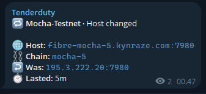
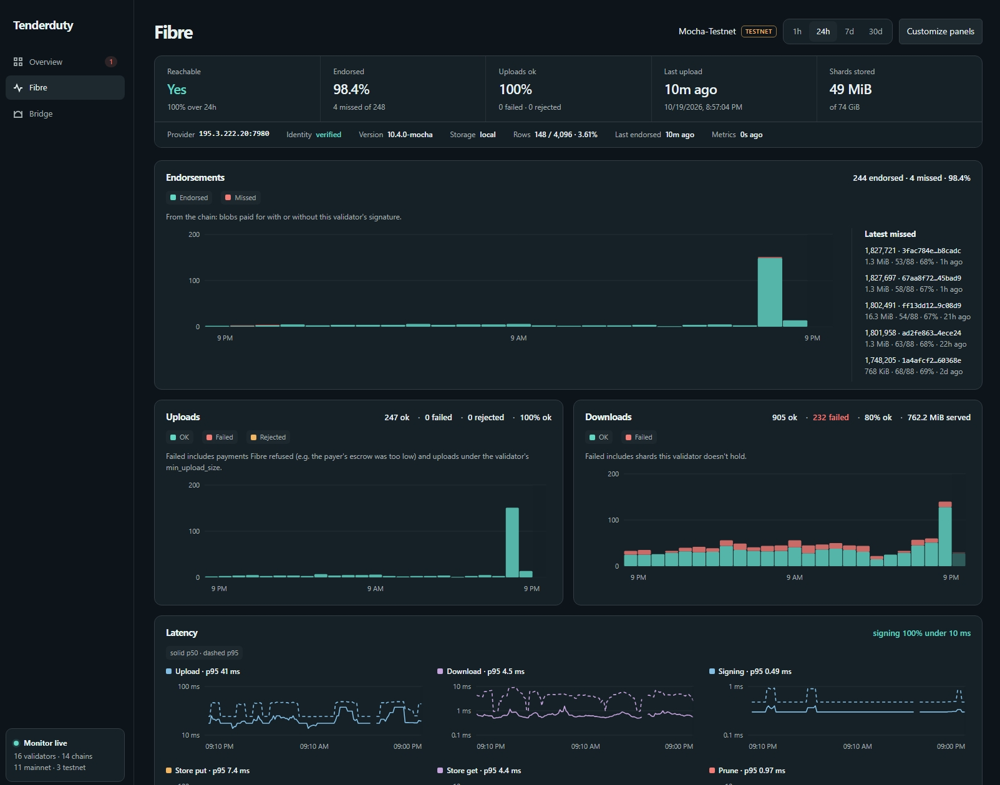

# Celestia Fibre

Tenderduty watches a validator's Fibre provider in two ways, both turned on per chain with `fibre_enabled` ([config.md](config.md#alerting-settings)):

- It asks the chain for the validator's registered Fibre host and dials it, without further setup. Chains without x/valaddr are skipped.
- With [`otel_metrics`](config.md#otel-metrics), it receives Fibre's OTLP/HTTP exports and can detect signing or disk failures even when Fibre answers.

Run tenderduty on a different machine from Fibre. The check then sees what Fibre's clients see, and still reports when Fibre's machine goes down.

## Setup

Fibre pushes its metrics to tenderduty; Fibre opens no port.

1. Open the listener, then restart tenderduty:

   ```shell
   tenderduty config set otel_metrics.listen=<ip>:4318 otel_metrics.token=generate
   ```

   `<ip>` is the address on tenderduty's machine that Fibre sends to: `127.0.0.1` on the same server or behind a proxy, the private IP over WireGuard or a LAN, `0.0.0.0` for all interfaces. See the cases below.

2. Turn on the chain and print the command for Fibre:

   ```shell
   tenderduty chain fibre <Name>
   ```

3. Start Fibre with the printed lines, replacing `<token>` with `otel_metrics.token` from `config.yml`.

`chain fibre` flags:

| Flag | Use |
| --- | --- |
| `--endpoint <url>` | Address Fibre should send to, when it differs from `listen` (NAT, proxy). |
| `--instance <name>` | Sets `fibre_instance`, for several validators on one chain. |
| `--off` | Turns the Fibre alerts off. |

Notes:

- The token goes in Fibre's environment as `OTEL_EXPORTER_OTLP_HEADERS`; Fibre has no flag for it. Loopback needs none; any other `listen` requires it unless `allow_without_token: yes`.
- `OTEL_RESOURCE_ATTRIBUTES="service.namespace=<chain_id>"` sends the metrics to that chain. Without it, they go to the chain whose `fibre_instance` matches Fibre's hostname, or to the only enabled Celestia chain without one if no labeled Fibre feeds it. Two Fibres on one host: label at least one. Unclaimed metrics are ignored.
- Any path ending in `/v1/metrics` is accepted, so `--otel-endpoint` is just the base URL.

### Same server

Loopback needs no token.

```yaml
# config.yml
otel_metrics:
  listen: 127.0.0.1:4318
```

```
OTEL_RESOURCE_ATTRIBUTES="service.namespace=mocha-5" \
  fibre start --otel-endpoint http://127.0.0.1:4318
```

### Private network

WireGuard, VPN or a provider's private LAN. Listen on the private address and allow only Fibre's IP to port 4318.

```yaml
otel_metrics:
  listen: 10.0.0.5:4318
  token: <token>
```

```
OTEL_EXPORTER_OTLP_HEADERS="authorization=Bearer <token>" \
OTEL_RESOURCE_ATTRIBUTES="service.namespace=mocha-5" \
  fibre start --otel-endpoint http://10.0.0.5:4318
```

Without a token (not recommended), set `allow_without_token: yes` and let only Fibre's IP in: `sudo ufw allow from <fibre-ip> to any port 4318 proto tcp`.

### Over the internet

Put Caddy or nginx in front for HTTPS and keep `listen` on loopback. Proxied requests come from 127.0.0.1, so tenderduty can't tell they came from the internet: use a token, or at least let only Fibre's IP through the proxy. Without either, anyone can send fake metrics and hide a broken Fibre.

```
# Caddyfile, the certificate is automatic
otel.example.com {
  @fibre remote_ip 203.0.113.7   # optional without a token: only Fibre's IP
  reverse_proxy @fibre 127.0.0.1:4318
}
```

```
# nginx, certificate from certbot
server {
  listen 443 ssl;
  server_name otel.example.com;
  ssl_certificate     /etc/letsencrypt/live/otel.example.com/fullchain.pem;
  ssl_certificate_key /etc/letsencrypt/live/otel.example.com/privkey.pem;
  location / {
    allow 203.0.113.7;   # optional without a token: only Fibre's IP
    deny all;
    proxy_pass http://127.0.0.1:4318;
  }
}
```

```yaml
otel_metrics:
  listen: 127.0.0.1:4318
  token: <token>   # leave out only with the IP rule above
```

```
OTEL_EXPORTER_OTLP_HEADERS="authorization=Bearer <token>" \
OTEL_RESOURCE_ATTRIBUTES="service.namespace=mocha-5" \
  fibre start --otel-endpoint https://otel.example.com
```

### Built-in HTTPS

Without a proxy, tenderduty can serve HTTPS itself (TLS 1.2 and up). With a self-signed certificate, point Fibre at it with `OTEL_EXPORTER_OTLP_CERTIFICATE`.

```yaml
otel_metrics:
  listen: 0.0.0.0:4318
  token: <token>
  tls_cert: /etc/tenderduty/cert.pem
  tls_key: /etc/tenderduty/key.pem
```

### Through a collector

If Fibre already sends to a collector, forward to tenderduty from there. Other metrics are ignored.

```yaml
# OpenTelemetry Collector
exporters:
  otlphttp/tenderduty:
    endpoint: https://otel.example.com   # behind Caddy/nginx; or http://<tenderduty-ip>:4318
    headers:
      authorization: Bearer <token>   # otel_metrics.token, also through the proxy
service:
  pipelines:
    metrics:
      exporters: [prometheus, otlphttp/tenderduty]
```

```
# Grafana Alloy
otelcol.exporter.otlphttp "tenderduty" {
  client {
    endpoint = "https://otel.example.com"   // or "http://<tenderduty-ip>:4318"
    headers = { authorization = "Bearer <token>" }
  }
}
```

In Alloy, add `otelcol.exporter.otlphttp.tenderduty.input` to the `output` metrics list of the block that receives Fibre's metrics.

## Alerts

All use the chain's `fibre_severity` (default warning) and send a recovery when they clear.

With `fibre_enabled`:

| Alert | Fires when |
| --- | --- |
| Validator is not a registered Fibre provider | The chain has no Fibre host for this validator. |
| Fibre at `host` is unreachable | The host fails a TLS handshake for `node_down_alert_minutes`. The alert says why. |
| Fibre at `host` is not ready | Its gRPC health service reports not serving for `node_down_alert_minutes`: the app node, signer, registration or store check fails. Needs Fibre v10.5; older servers are not checked. |
| Fibre at `host` does not prove it belongs to this validator | Its certificate isn't signed by this validator's consensus key. |

When the registered host changes, these clear as Host changed:



With [`otel_metrics`](#setup) too:

| Alert | Fires when |
| --- | --- |
| Fibre has sent no metrics | No metrics for `node_down_alert_minutes`. |
| Fibre could not sign payment promises | Over 1% of signatures fail. |
| Fibre signing is slower than 10ms | Most signatures take over 10ms. |
| Fibre storage operations are failing | A store write or prune failed in the last 10 minutes. |
| Fibre storage backend requests are failing | Over 1% of backend reads fail or time out. |

Optional, each turned on by its setting:

| Setting | Alert | Fires when |
| --- | --- | --- |
| `fibre_storage_percent` | Fibre shard budget is nearly full | Use reaches that percent, or an upload was turned away. See [the shard budget](#the-shard-budget). |
| `fibre_idle_minutes` | Fibre has had no successful upload | No upload for that many minutes. Only for steady uploads. |
| `fibre_endorsement_alert` | Fibre is not endorsing | No endorsement for 50 blobs and 120 minutes. Not while your node is down or the validator is jailed. |

Rate alerts look at the last 10 minutes, so one can stay active for a while after the fix.

## The shard budget

Tenderduty shows how much of Fibre's shard budget is used. The budget is `full_stake_storage_budget x rows / 4096`, with `rows = ceil(4096 x stake share x 3)` between 148 and 4096 (74 GiB at 148 rows on Mocha). It counts shards only, not Fibre's metadata or staging.

- `fibre_storage_percent` (1 to 100, off by default) alerts when use reaches that percent or an upload was turned away in the last 10 minutes. It clears 15 points lower with no rejected uploads for 30 minutes.
- With `fibre start --unlimited-budget` the budget reads 0 and the alert never fires.

## Endorsements

Tenderduty reads `MsgPayForFibre` in each block and checks whether this validator signed the payment promise.

- **Endorsed:** a blob paid for with this validator's signature. **Missed:** paid for without it. **Unknown:** the validator set at that height was unavailable. Misses alone don't alert.
- **Stop alert** (`fibre_endorsement_alert`, off by default): fires after `fibre_endorsement_blobs` (50) blobs and `fibre_endorsement_minutes` (120) minutes without an endorsement. The next endorsement resets it; unknown results don't.
- Only blobs seen while tenderduty runs count. Streaks survive a restart.

The dashboard shows Endorsing, `/status` shows it when stopped, and daily and weekly reports include the rate and the longest stop.

## /status and the dashboard

`/status <chain>` in Telegram and the dashboard's validator detail show Fibre's host, reachability, identity, readiness, version, row share, shards against the budget with the storage backends, endorsements over 24 hours, last successful upload and metrics age. Host, endorsements, share and budget come from the chain; reachability, identity and readiness are probed directly; the rest comes from Fibre's metrics.


The Fibre tab charts one chain over 1h, 24h, 7d or 30d: endorsements with the latest misses, latency, signing, errors, uploads and downloads, and Go resources. Customize panels shows, hides and reorders them. Hourly rollups are kept for 30 days in the state file. Fibre doesn't export CPU or process RSS; use node_exporter or process-exporter for those.



`GET /fibre?range=24h&chain=ChainName` returns the same data as JSON (all watched chains without `chain`). Points include `endorsements_endorsed`, `endorsements_missed` and `endorsements_unknown` counts in `metrics`; the summary includes `last_24h.endorsed`, `last_24h.missed`, `last_24h.unknown` and `latest_missed` (up to 20). Endorsements and missed blobs stay visible with `hide_logs`.

## Prometheus and Grafana

With `prometheus_enabled: yes`, `/metrics` adds these, prefixed `tenderduty_fibre_` and labeled `name`, `chain_id` and `moniker`. Counters (`_total`) and the latency histograms (`upload_seconds`, `sign_seconds` and so on) reset on restart, so use `rate` or `increase`.

| Group | Metrics |
| --- | --- |
| Status | `registered`, `reachable`, `identity_verified`, `ready` (when reported), `metrics_age_seconds` |
| Share and budget | `rows`, `rows_total`, `row_share` (0 to 1), `chain_budget_bytes`, `budget_bytes` (0 is unlimited), `occupancy_bytes` |
| Endorsements | `endorsements_total{result="endorsed\|missed\|unknown"}` |
| Uploads | `uploads_total{result="ok\|failed\|rejected"}`, `upload_bytes_total`, `upload_seconds`, `uploads_in_flight`, `last_upload_timestamp_seconds` |
| Downloads | `downloads_total{result="ok\|failed"}`, `download_bytes_total`, `download_seconds`, `downloads_in_flight` |
| Signing | `signatures_total{result="ok\|failed"}`, `signatures_fast_total`, `sign_seconds_total`, `sign_seconds` |
| Storage | `store_errors_total{op="put\|get\|prune"}`, `store_put_seconds`, `store_get_seconds`, `prune_seconds`, `prune_entries_total` |
| Storage backend | `storage_backend_requests_total{backend,outcome}`, `storage_backend_bytes_total{backend}`, `storage_backend_in_flight{backend}` |
| Go runtime | `go_memory_used_bytes`, `go_memory_heap_bytes`, `go_memory_stack_bytes`, `go_memory_limit_bytes`, `go_gc_goal_bytes`, `go_goroutines`, `go_processor_limit`, `go_gogc`, `go_memory_allocated_bytes_total`, `go_memory_allocations_total`, `go_schedule_seconds` |

`outcome` is success, not_found, canceled, timeout, throttled, error or unknown. Go runtime metrics Fibre doesn't send are left out, such as `go_memory_limit_bytes` without a limit and `go_schedule_seconds`.

Grafana: **Dashboards > New > Import**, upload [`examples/grafana/fibre.json`](../examples/grafana/fibre.json), then pick your Prometheus datasource and chain.

### Raw export

`otel_metrics.export_raw: yes` (default no, needs `prometheus_enabled`) also serves every metric Fibre and the bridge send, with the names an OpenTelemetry Collector would give them, so the official Celestia Fibre dashboard works unchanged.

- Labels: the metric's own, `service_name`, `service_instance_id`, `service_version`, `name` and `chain_id`.
- Exponential histograms and summaries are skipped.
- A series not seen for 10 minutes is dropped; each chain keeps at most 20,000.
- Applies on reload, and can stay on next to the `tenderduty_fibre_*` metrics.
