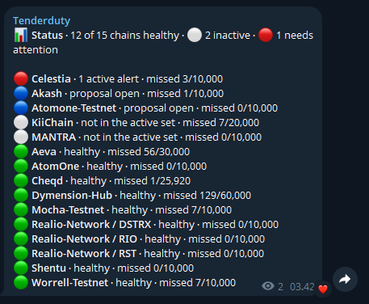
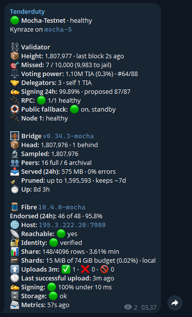

# Telegram configuration

1. Create a channel or group on Telegram, or use a private chat with the bot. You can add people later.
2. Create a bot with [@BotFather](https://core.telegram.org/bots/features#botfather) (`/newbot`). Paste its token into `read -s BOT_TOKEN`, which keeps it out of shell history.
3. Add the bot to the chat as an admin so it can post.
4. Post any message in the chat, then get its id (before tenderduty runs with `commands: yes`, which reads the same updates):

   ```shell
   curl -s "https://api.telegram.org/bot$BOT_TOKEN/getUpdates" | grep -o '"chat":{"id":-\?[0-9]*'
   ```

   Channel and supergroup ids start with `-100`, like `-1001068773197`. A private chat's id is your user id.

Then:

```shell
echo "$BOT_TOKEN" | tenderduty config set telegram.api_key=-
tenderduty config set telegram.enabled=yes telegram.channel=-1001068773197 telegram.commands=yes
```

Or in `config.yml`:

```yaml
telegram:
  enabled: yes
  api_key: "your-bot-token"
  channel: "-1001068773197"
  commands: yes
  # admins: [123456789]   # group only: user ids allowed to send commands
```

Set these in the shared part of `config.yml`, or per chain under `alerts.telegram`.

## Commands

With `commands: yes`, tenderduty answers these in the configured chat:

* `/status` gives a line per chain, problems first.

  

* `/status <chain>` gives one chain in full: height, misses and how many are left before jailing, voting power and rank, RPC nodes and active alerts. Nodes with `alert_if_down` show their celestia-app version; `hide_logs` hides the node lines. The chain is its name or chain id. It also shows [Fibre](fibre.md#status-and-the-dashboard) and the [bridge](bridge.md#status-and-the-dashboard) when set.

  

* `/report` and `/report weekly` show the current daily or weekly [report](config.md#reports).
* `/mentionme` pings you in every alert sent to this chat. `/mentionme off` stops these pings. The preference is saved with the state.

Who can use them:

- Tenderduty listens only to the chat in `channel`: a channel, a group, or a private chat with the bot (your user id).
- In a channel or private chat, anyone who can post. In a group, only the user ids in `admins`. To find yours, send `/status` once: the log shows `/status from user id <id> ignored, not in telegram.admins`.
- Use a bot only for tenderduty: Telegram lets one program read a bot's messages, so a shared bot loses commands.
